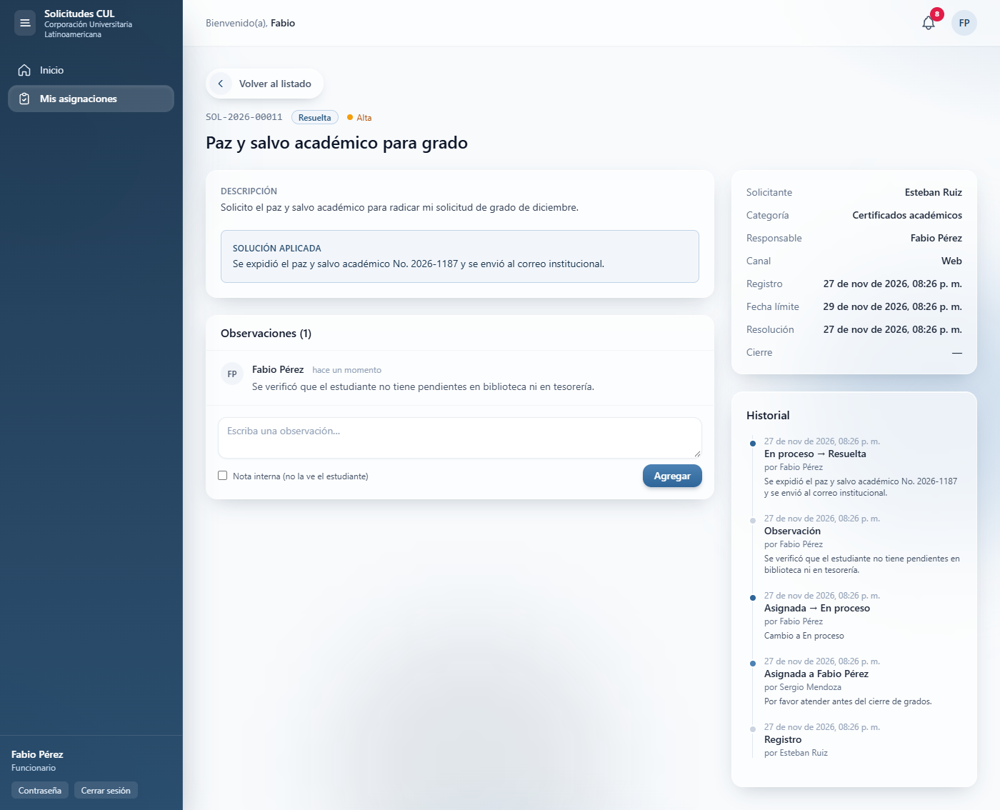

# SGSU — Sistema de Gestión de Solicitudes Universitarias

Aplicación web para **registrar, asignar, atender y consultar** las solicitudes de servicios que estudiantes y funcionarios hacen a la universidad. Reemplaza la atención dispersa por correo, WhatsApp y ventanilla con un único sistema que guarda el historial de cada caso, controla los tiempos de respuesta y entrega estadísticas.

Proyecto final de **Ingeniería del Software** · 2026



## Funcionalidades

- **4 roles**: Administrador, Estudiante, Funcionario y Supervisor, con permisos validados en el servidor (JWT + bcrypt).
- **Ciclo de vida**: `REGISTRADA → ASIGNADA → EN PROCESO → RESUELTA → CERRADA`, más `RECHAZADA` y `REABIERTA`, con reglas de negocio (patrón *State*).
- **Historial** de cada cambio con fecha, usuario y motivo. **Observaciones** públicas e internas.
- **Fecha límite (SLA)** por categoría e indicador de solicitudes **vencidas**.
- **Notificaciones** internas y correo opcional (patrón *Observer*).
- **Reportes** por estado, categoría, prioridad, responsable y periodo, con exportación a CSV.
- Gestión de **usuarios, roles, categorías y parámetros**.

## Tecnologías

| Capa | Tecnología |
|---|---|
| Backend | Python · FastAPI · SQLAlchemy 2.0 · Pydantic |
| Base de datos | PostgreSQL 16 (SQLite para desarrollo y pruebas) |
| Seguridad | JWT (PyJWT) · bcrypt |
| Frontend | Svelte 4 · Vite · Tailwind CSS |
| Calidad | pytest · pytest-cov · GitHub Actions |
| Despliegue | Docker · docker-compose |

## Inicio rápido

**Con Docker** (incluye PostgreSQL):

```bash
docker compose up --build
# abrir http://localhost:8000
```

**Sin Docker** (usa SQLite automáticamente):

```bash
cd backend
python -m venv .venv && .venv\Scripts\activate     # Linux/Mac: source .venv/bin/activate
pip install -r requirements.txt
uvicorn app.main:app --reload                       # API: http://localhost:8000/docs

cd ../frontend
npm install && npm run dev                          # Interfaz: http://localhost:5173
```

Usuarios de demostración (contraseña `Demo1234*`): `estudiante@`, `funcionario@`, `supervisor@` y `admin@universidad.edu.co`.

Las instrucciones completas están en el [manual de instalación y uso](docs/05-informe-final.md#manual-de-instalación).

## Pruebas

```bash
cd backend
pip install -r requirements-dev.txt
pytest --cov=app        # 43 pruebas · 92 % de cobertura
```

## Estructura

```
├── backend/
│   ├── app/
│   │   ├── api/            # Routers REST y control de acceso por rol
│   │   ├── core/           # Configuración, BD, seguridad, excepciones
│   │   ├── domain/         # Enumeraciones y máquina de estados (State)
│   │   ├── models/         # Entidades (Rol, Usuario, Categoria, Solicitud, …)
│   │   ├── repositories/   # Acceso a datos (Repository)
│   │   ├── schemas/        # DTOs Pydantic
│   │   ├── services/       # Lógica de negocio y notificaciones (Observer)
│   │   ├── bootstrap.py    # Tablas y datos de demostración
│   │   └── main.py
│   ├── sql/                # Esquema relacional (PostgreSQL)
│   └── tests/              # Pruebas automatizadas
├── frontend/src/           # Páginas, componentes y cliente de la API
├── docs/                   # Entregas 1–5, diagramas UML y evidencias
├── Dockerfile
└── docker-compose.yml
```

## Documentación

| Entrega | Documento |
|---|---|
| 1 | [Inicio y planificación](docs/01-inicio-planificacion.md) |
| 2 | [Análisis: requisitos, casos de uso, E-R, estados](docs/02-analisis.md) |
| 3 | [Diseño: arquitectura, clases, BD, patrones](docs/03-diseno.md) |
| 4 | [Implementación, pruebas y métricas](docs/04-implementacion-pruebas.md) |
| 5 | [Informe final y manual](docs/05-informe-final.md) |

## Equipo

| Integrante | Rol |
|---|---|
| Juan David Bello | Backend / líder técnico |
| _Integrante 2_ | Análisis y documentación |
| _Integrante 3_ | Frontend y QA |

Docente: Kevin Villarreal Jiménez · Asignatura: Ingeniería del Software
