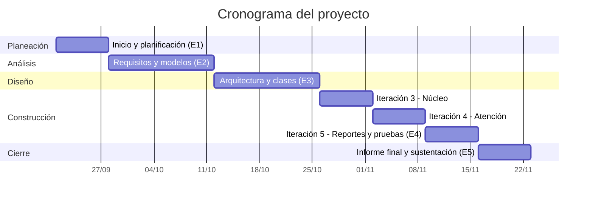

# Entrega 1 — Inicio y planificación

## 1.1 Nombre del proyecto

**SGSU — Sistema de Gestión de Solicitudes Universitarias**

## 1.2 Descripción del problema

La institución recibe solicitudes de estudiantes y funcionarios por varios canales: correo electrónico, mensajería instantánea (WhatsApp) y atención presencial en ventanilla. Cada dependencia lleva su propio control (hojas de cálculo, bandejas de correo, cuadernos), lo que produce:

| Problema observado | Consecuencia |
|---|---|
| No existe un registro único de solicitudes | Casos perdidos o duplicados; no se sabe cuántas solicitudes llegan |
| La asignación de responsables es informal | Nadie se hace cargo o dos personas atienden lo mismo |
| No hay trazabilidad | El estudiante no sabe en qué va su caso y debe preguntar varias veces |
| No se miden tiempos de respuesta | No es posible saber qué dependencias incumplen ni planear personal |
| No hay estadísticas consolidadas | Las decisiones se toman sin datos |

## 1.3 Justificación

Centralizar la gestión en un sistema web con un ciclo de vida definido permite:

- Un **único punto de registro** al que se accede con usuario institucional.
- **Asignación explícita** de responsables con historial de quién hizo qué y cuándo.
- **Control de tiempos** mediante una fecha límite calculada según el tipo de solicitud (SLA por categoría).
- **Transparencia** para el estudiante (estado, observaciones y notificaciones).
- **Indicadores** para que la supervisión tome decisiones (volumen por categoría, vencidas, cumplimiento, tiempo promedio de resolución).

## 1.4 Objetivos

### Objetivo general

Desarrollar una aplicación web que permita registrar, asignar, atender y consultar solicitudes de servicios universitarios, aplicando técnicas de Ingeniería de Software: análisis y diseño orientado a objetos, gestión del proyecto, pruebas y métricas de calidad.

### Objetivos específicos

1. Levantar y especificar los requisitos funcionales, no funcionales y reglas de negocio del proceso de atención de solicitudes.
2. Modelar el sistema con UML (casos de uso, clases, estados, actividades) y diseñar una base de datos relacional normalizada.
3. Implementar una arquitectura por capas con autenticación y control de acceso por roles.
4. Implementar el ciclo de vida de las solicitudes respetando las reglas de negocio, con historial completo de cambios.
5. Generar notificaciones internas y reportes estadísticos para la supervisión.
6. Verificar la solución con pruebas automatizadas y medir su calidad con métricas de código.

## 1.5 Alcance

**Incluido:**

- Gestión de usuarios y asignación de roles (Administrador, Estudiante, Funcionario, Supervisor).
- Gestión de categorías de solicitud (con dependencia responsable y tiempo de respuesta) y de parámetros del sistema.
- Registro de solicitudes con descripción, categoría, prioridad, canal de origen y datos del solicitante.
- Asignación y reasignación de responsables, observaciones (públicas e internas) y cambios de estado.
- Ciclo de vida: REGISTRADA → ASIGNADA → EN PROCESO → RESUELTA → CERRADA, más RECHAZADA y REABIERTA.
- Historial de movimientos por solicitud.
- Notificaciones internas y envío opcional por correo.
- Reportes por estado, categoría, prioridad, responsable y periodo; exportación a CSV.

**Límites (fuera del alcance):**

- Integración con el sistema académico/financiero real de la universidad (los datos de estudiantes se registran en el SGSU).
- Inicio de sesión único (SSO / Microsoft 365). Se deja como mejora futura.
- Carga de archivos adjuntos.
- Aplicación móvil nativa (la web es responsiva y funciona en el celular).
- Recepción automática de solicitudes desde correo o WhatsApp: el canal se registra como dato, pero la solicitud la crea el usuario en el sistema.

## 1.6 Actores

| Actor | Descripción | Responsabilidades en el sistema |
|---|---|---|
| **Administrador** | Personal de la Oficina TIC | Gestiona usuarios, roles, categorías y parámetros. Puede asignar responsables y consultar reportes |
| **Estudiante** | Solicitante principal | Registra solicitudes, consulta **solo las suyas**, agrega observaciones, cierra o reabre cuando no queda conforme |
| **Funcionario** | Personal de las dependencias | Atiende las solicitudes asignadas: inicia la atención, registra observaciones, resuelve o rechaza. También puede registrar solicitudes propias |
| **Supervisor** | Coordinación / Vicerrectoría | Consulta indicadores y reportes, asigna y reasigna responsables y autoriza reaperturas |
| *Sistema (secundario)* | Proceso interno | Genera el código, calcula la fecha límite y envía las notificaciones |

## 1.7 Modelo de proceso seleccionado

**Modelo incremental con iteraciones cortas (Scrum adaptado a un equipo académico de 3 personas).**

Justificación:

- **Entregas parciales obligatorias.** La asignatura exige 5 entregas; cada una se trata como un incremento revisable (planificación → análisis → diseño → implementación → cierre).
- **Requisitos estables pero refinables.** Los módulos obligatorios están definidos en el enunciado, pero detalles como las transiciones de RECHAZADA/REABIERTA o qué rol asigna se precisaron durante el análisis. Un modelo en cascada puro no admite bien esos ajustes.
- **Riesgo técnico moderado.** Construir primero el núcleo (autenticación + ciclo de vida) y validarlo con pruebas reduce el riesgo antes de agregar reportes y notificaciones.
- **Equipo pequeño.** Scrum completo (con todos sus roles y ceremonias) es excesivo; se adoptan solo: backlog priorizado, iteraciones de 1–2 semanas, reunión corta de seguimiento y revisión al final de cada iteración.

Artefactos usados: product backlog (historias de usuario de la [Entrega 2](02-analisis.md#24-historias-de-usuario)), tablero de tareas (GitHub Projects/Issues) y control de versiones con ramas por funcionalidad.

## 1.8 Cronograma

> Ajuste las fechas de inicio según el calendario real del equipo. La entrega final es el **28 de noviembre de 2026**.

| Iteración | Semanas | Entregable | Actividades principales |
|---|---|---|---|
| 0. Inicio | 1 | Entrega 1 | Definición del problema, alcance, actores, riesgos, cronograma, creación del repositorio |
| 1. Análisis | 2 | Entrega 2 | Requisitos, reglas de negocio, historias de usuario, casos de uso, modelo E-R, diagrama de estados |
| 2. Diseño | 2 | Entrega 3 | Arquitectura, diagrama de clases, BD relacional, prototipos, patrones |
| 3. Núcleo | 1 | — | Modelo de datos, autenticación JWT, roles, registro y consulta de solicitudes |
| 4. Atención | 1 | — | Asignación, máquina de estados, observaciones, historial, notificaciones |
| 5. Reportes y calidad | 1 | Entrega 4 | Reportes, interfaz completa, pruebas automatizadas, métricas |
| 6. Cierre | 1 | Entrega 5 | Informe final, manual, despliegue, preparación de la sustentación |

## 1.9 Distribución de responsabilidades

> Reemplace "Integrante 2" e "Integrante 3" por los nombres reales del equipo.

| Integrante | Rol en el equipo | Responsabilidades principales |
|---|---|---|
| Juan David Bello | Líder técnico / backend | Arquitectura, modelo de datos, API, máquina de estados, pruebas del backend |
| Integrante 2 | Analista / documentación | Requisitos, historias de usuario, casos de uso, diagramas UML, informe final |
| Integrante 3 | Frontend / QA | Prototipos, interfaz Svelte, pruebas funcionales, evidencias, manual de usuario |

Todos los integrantes participan en la revisión de cada entrega y deben conocer el funcionamiento completo para la sustentación.

## 1.10 Riesgos y mitigación

| # | Riesgo | Prob. | Impacto | Mitigación |
|---|---|---|---|---|
| R1 | Requisitos ambiguos (p. ej. quién puede reabrir) | Media | Alto | Reglas de negocio escritas y validadas con el docente; quedan codificadas en una sola clase (máquina de estados) para cambiarlas fácilmente |
| R2 | Retraso de un integrante | Media | Alto | Tareas pequeñas en el tablero, revisión semanal, conocimiento compartido (todos revisan PRs) |
| R3 | Falla de seguridad (contraseñas, acceso indebido) | Baja | Alto | bcrypt para contraseñas, JWT con expiración, verificación de rol en el backend en cada endpoint, pruebas de permisos |
| R4 | Inconsistencia de datos (estados imposibles) | Media | Alto | Transiciones validadas por el patrón State, restricciones CHECK y llaves foráneas en la BD |
| R5 | Pérdida de código | Baja | Alto | Repositorio GitHub, commits frecuentes, integración continua |
| R6 | Dependencia de un servicio externo (hosting/BD gratuita) caído el día de la sustentación | Media | Medio | La app corre localmente con SQLite o con Docker + PostgreSQL sin configuración adicional |
| R7 | Diagramas desactualizados frente al código | Alta | Medio | Diagramas en Mermaid dentro del repositorio, revisados junto con el código; prueba automática que compara la máquina de estados con el diseño |
| R8 | Correo institucional bloquea el envío SMTP | Media | Bajo | El correo es opcional; las notificaciones internas no dependen de él |
