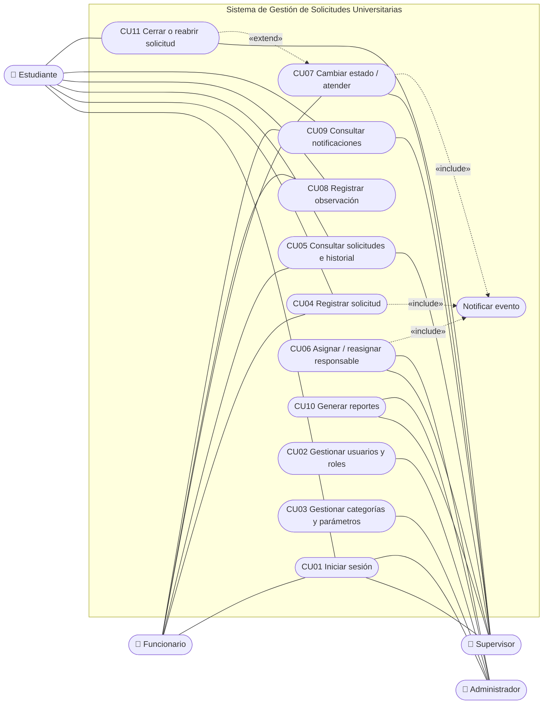
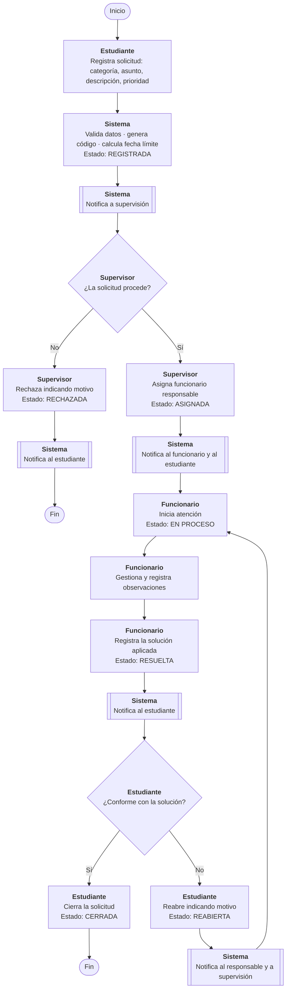
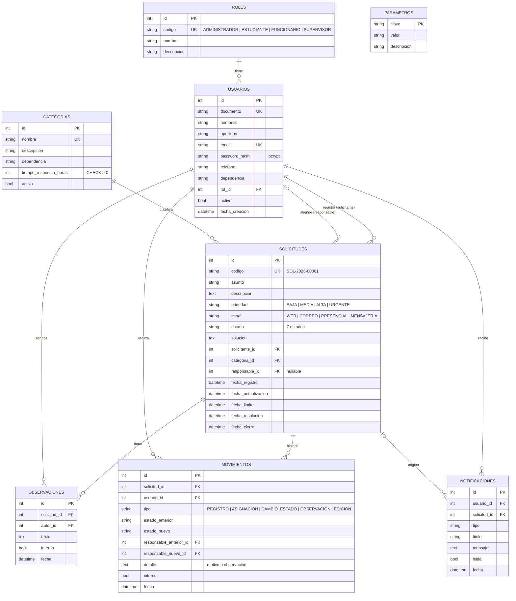
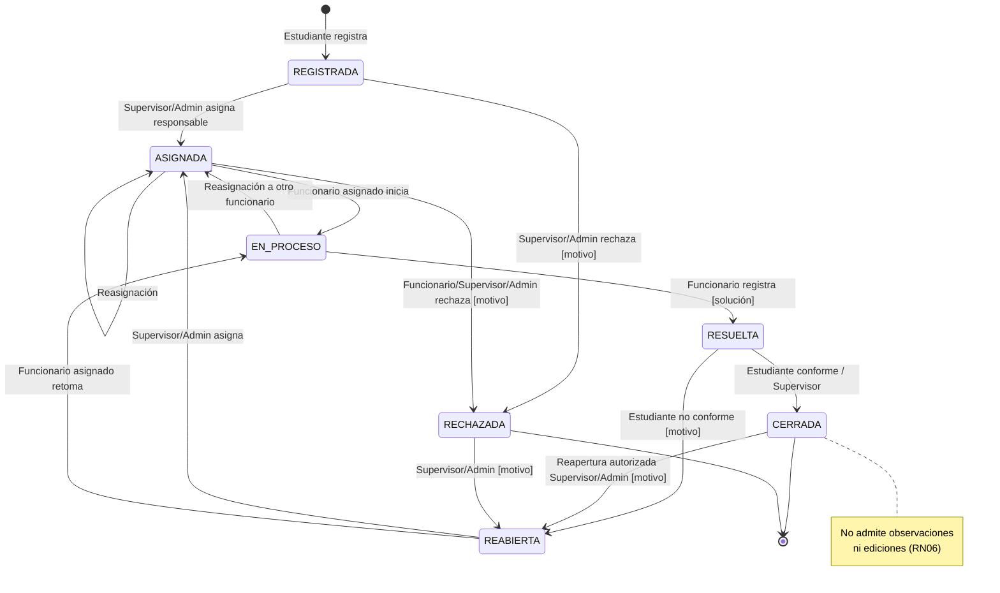

# Entrega 2 — Análisis del sistema

## 2.1 Requisitos funcionales

| Código | Requisito | Actor(es) | Módulo | Implementación |
|---|---|---|---|---|
| RF01 | Iniciar sesión y controlar el acceso según el rol | Todos | Autenticación | `POST /api/auth/login`, `api/deps.py` |
| RF02 | Gestionar usuarios (crear, consultar, editar, activar/desactivar) y asignar roles | Administrador | Usuarios | `/api/usuarios`, `UsuarioService` |
| RF03 | Gestionar categorías de solicitud (crear, editar, activar/desactivar, tiempo de respuesta) | Administrador | Categorías | `/api/categorias`, `CategoriaService` |
| RF04 | Registrar una solicitud con asunto, descripción, categoría, prioridad y canal | Estudiante, Funcionario | Registro | `POST /api/solicitudes` |
| RF05 | Consultar las solicitudes propias y su estado, con filtros | Estudiante | Seguimiento | `GET /api/solicitudes` |
| RF06 | Consultar las solicitudes asignadas | Funcionario | Atención | `GET /api/solicitudes?alcance=asignadas` |
| RF07 | Actualizar el estado respetando las reglas de negocio | Funcionario, Supervisor, Admin, Estudiante (cerrar/reabrir) | Atención | `POST /api/solicitudes/{id}/estado`, `domain/estados.py` |
| RF08 | Registrar observaciones y la solución aplicada | Todos los involucrados | Atención | `POST /api/solicitudes/{id}/observaciones` |
| RF09 | Conservar y consultar el historial de cambios | Todos (según permisos) | Seguimiento | `GET /api/solicitudes/{id}/historial`, tabla `movimientos` |
| RF10 | Generar notificaciones internas al registrar, asignar, cambiar estado u observar | Sistema | Notificaciones | `services/eventos.py` |
| RF11 | Generar reportes y estadísticas por estado, categoría, prioridad, responsable y periodo | Supervisor, Admin | Reportes | `GET /api/reportes/resumen` |
| RF12 | Asignar y reasignar el responsable de una solicitud | Supervisor, Admin | Asignación | `POST /api/solicitudes/{id}/asignar` |
| RF13 | Administrar parámetros del sistema (prefijo de código, SLA por defecto, envío de correo) | Administrador | Parámetros | `/api/parametros` |
| RF14 | Exportar el reporte de solicitudes a CSV | Supervisor, Admin | Reportes | `GET /api/reportes/exportar` |
| RF15 | Cambiar la propia contraseña | Todos | Autenticación | `POST /api/auth/cambiar-password` |
| RF16 | Enviar notificaciones por correo (opcional, configurable) | Sistema | Notificaciones | `CorreoObserver` |

## 2.2 Requisitos no funcionales

| Código | Atributo | Requisito | Cómo se cumple / se verifica |
|---|---|---|---|
| RNF01 | Seguridad | Las contraseñas no se almacenan en texto plano | Hash **bcrypt** con sal (`core/security.py`); prueba `test_hash_password_no_guarda_texto_plano` |
| RNF02 | Seguridad | Toda operación exige autenticación y permisos por rol, validados en el servidor | Token **JWT** con expiración; dependencias `get_current_user` y `require_roles`; pruebas CP04, CP05, CP15–CP18, CP27 y CP30 |
| RNF03 | Seguridad | Mensajes de error de login no revelan si el correo existe | Mismo mensaje para correo inexistente o clave errada |
| RNF04 | Usabilidad | Las tareas frecuentes (registrar, consultar, cambiar estado) se hacen en ≤ 3 clics desde el inicio | Botón "Nueva solicitud" en inicio; acciones disponibles visibles en el detalle; solo se muestran los botones permitidos |
| RNF05 | Usabilidad | Interfaz en español, responsiva (escritorio y celular) | Tailwind CSS con diseño adaptable; evidencia en `docs/img/20-movil.png` |
| RNF06 | Integridad | Datos relacionados consistentes | Llaves foráneas, restricciones `UNIQUE` y `CHECK` (estados, prioridades, canales, tiempo > 0); no se borran categorías ni usuarios, se desactivan |
| RNF07 | Integridad | Validación de datos obligatorios en cliente y servidor | Esquemas Pydantic (longitudes, formatos, enumeraciones) + atributos `required` en formularios |
| RNF08 | Disponibilidad | Servicio accesible en horario académico (lunes a sábado, 6:00–22:00) | Despliegue en contenedor Docker; endpoint `/api/health` para monitoreo; ejecución local sin dependencias externas como contingencia |
| RNF09 | Mantenibilidad | Arquitectura por capas, bajo acoplamiento, patrones de diseño | Capas API → Servicios → Dominio → Repositorios → Modelos; complejidad ciclomática promedio **A (2.3)** |
| RNF10 | Mantenibilidad | Cobertura de pruebas automatizadas ≥ 80 % del backend | **92 %** de cobertura (pytest-cov) |
| RNF11 | Rendimiento | Consultas habituales < 1 s con 10.000 solicitudes | Índices en estado, fechas, solicitante, responsable y categoría; conteos con `GROUP BY` en la BD |
| RNF12 | Portabilidad | Funciona con PostgreSQL (producción) y SQLite (desarrollo/pruebas) | ORM SQLAlchemy; verificado en ambos motores |

## 2.3 Reglas de negocio y restricciones

| Código | Regla | Dónde se aplica |
|---|---|---|
| RN01 | Una solicitud solo puede ser registrada por un usuario autenticado con rol Estudiante o Funcionario | `SolicitudService.registrar` |
| RN02 | Toda solicitud debe estar asociada a una **categoría activa** | `SolicitudService.registrar` / `editar` |
| RN03 | El estado inicial es **REGISTRADA**; el sistema genera el código `PREFIJO-AÑO-NNNNN` y la fecha límite = fecha de registro + horas de respuesta de la categoría | `SolicitudService.registrar` |
| RN04 | Solo el **Administrador o el Supervisor** asignan o reasignan responsables, y el responsable debe ser un **Funcionario activo** | `SolicitudService.asignar` |
| RN05 | Para marcar una solicitud como **RESUELTA** debe registrarse la solución aplicada | `ReglaTransicion(requiere_solucion=True)` |
| RN06 | Una solicitud **CERRADA** no admite observaciones ni ediciones; solo puede **reabrirse** por Administrador o Supervisor, indicando el motivo | Clase `Cerrada` |
| RN07 | Cada cambio de estado guarda fecha, usuario, estado anterior, estado nuevo y motivo/observación | Tabla `movimientos` |
| RN08 | El Estudiante únicamente consulta sus propias solicitudes | `SolicitudService.listar` / `_verificar_acceso` |
| RN09 | El Funcionario consulta las solicitudes asignadas a él (y las que él mismo registró). Al ser reasignada, pierde el acceso | `SolicitudService.listar` |
| RN10 | Solo el funcionario **asignado** puede iniciar, resolver o rechazar una solicitud asignada | `ReglaTransicion(responsable=True)` |
| RN11 | **RECHAZADA** y **REABIERTA** requieren motivo obligatorio | `ReglaTransicion(requiere_motivo=True)` |
| RN12 | El solicitante puede editar asunto y descripción solo mientras la solicitud está REGISTRADA; el personal puede reclasificar (categoría/prioridad) mientras no esté cerrada o rechazada | `SolicitudService.editar` |
| RN13 | Las observaciones internas no son visibles para el estudiante | `SolicitudService.detalle` |
| RN14 | No se eliminan usuarios ni categorías con historial: se desactivan. Debe existir al menos un administrador activo | `UsuarioService`, `CategoriaService` |
| RN15 | Una solicitud está **vencida** si no está finalizada (resuelta, cerrada o rechazada) y superó su fecha límite | `Solicitud.vencida` |

### Transiciones permitidas

| Desde | Hacia | Quién | Exige |
|---|---|---|---|
| REGISTRADA | ASIGNADA | Admin, Supervisor (al asignar responsable) | Responsable |
| REGISTRADA | RECHAZADA | Admin, Supervisor | Motivo |
| ASIGNADA | EN_PROCESO | Funcionario asignado | — |
| ASIGNADA | RECHAZADA | Funcionario asignado, Admin, Supervisor | Motivo |
| EN_PROCESO | RESUELTA | Funcionario asignado | Solución |
| EN_PROCESO | ASIGNADA | Admin, Supervisor (reasignación) | Nuevo responsable |
| RESUELTA | CERRADA | Estudiante solicitante, Admin, Supervisor | — |
| RESUELTA | REABIERTA | Estudiante solicitante, Admin, Supervisor | Motivo |
| CERRADA | REABIERTA | Admin, Supervisor (reapertura autorizada) | Motivo |
| RECHAZADA | REABIERTA | Admin, Supervisor | Motivo |
| REABIERTA | ASIGNADA | Admin, Supervisor (asignar) | Responsable |
| REABIERTA | EN_PROCESO | Funcionario asignado | — |

## 2.4 Historias de usuario

| ID | Historia | Criterios de aceptación | Prioridad | RF |
|---|---|---|---|---|
| HU01 | Como **usuario** quiero iniciar sesión con mi correo y contraseña para acceder a las funciones de mi rol | 1) Con credenciales válidas entra a su inicio. 2) Con credenciales inválidas ve "Correo o contraseña incorrectos". 3) Un usuario inactivo no puede entrar. 4) El menú solo muestra las opciones de su rol | Alta | RF01 |
| HU02 | Como **administrador** quiero crear usuarios y asignarles un rol para que puedan usar el sistema | 1) Correo y documento únicos. 2) Contraseña mínimo 8 caracteres, guardada cifrada. 3) Puedo cambiar el rol desde el listado. 4) No puedo quitar el último administrador | Alta | RF02 |
| HU03 | Como **administrador** quiero gestionar las categorías con su tiempo de respuesta para clasificar las solicitudes y medir el cumplimiento | 1) Nombre único. 2) Horas > 0. 3) Una categoría inactiva no aparece al registrar | Alta | RF03 |
| HU04 | Como **estudiante** quiero registrar una solicitud indicando categoría, asunto, descripción y prioridad para no tener que ir a ventanilla | 1) Campos obligatorios validados. 2) Queda en estado Registrada con código único y fecha límite. 3) Recibo confirmación. 4) Supervisores y administradores reciben aviso | Alta | RF04, RF10 |
| HU05 | Como **estudiante** quiero ver mis solicitudes y su estado para saber cómo van | 1) Solo veo las mías. 2) Puedo filtrar por estado, categoría, prioridad y fechas. 3) Veo el historial y las observaciones no internas | Alta | RF05, RF09 |
| HU06 | Como **supervisor** quiero asignar una solicitud a un funcionario para que alguien sea responsable | 1) Solo aparecen funcionarios activos. 2) La solicitud pasa a Asignada. 3) El funcionario y el estudiante reciben aviso. 4) Queda registrado en el historial | Alta | RF12, RF10 |
| HU07 | Como **funcionario** quiero ver las solicitudes que tengo asignadas, ordenadas por urgencia | 1) Solo veo las asignadas a mí. 2) Se resaltan las vencidas | Alta | RF06 |
| HU08 | Como **funcionario** quiero cambiar el estado y registrar la solución para dejar constancia de la atención | 1) Solo veo las acciones permitidas. 2) No puedo resolver sin escribir la solución. 3) Rechazar exige motivo. 4) Cada cambio queda en el historial con fecha y usuario | Alta | RF07, RF08, RF09 |
| HU09 | Como **estudiante** quiero cerrar mi solicitud resuelta o reabrirla si no quedé conforme | 1) Solo cuando está Resuelta. 2) Reabrir exige motivo. 3) Una vez cerrada ya no puedo modificarla | Media | RF07 |
| HU10 | Como **usuario** quiero recibir notificaciones dentro del sistema cuando cambia algo en mis solicitudes | 1) Contador de no leídas en la barra superior. 2) Al abrir la notificación voy a la solicitud. 3) Puedo marcar todas como leídas | Media | RF10 |
| HU11 | Como **supervisor** quiero ver estadísticas por estado, categoría, prioridad, responsable y periodo para tomar decisiones | 1) Filtro por rango de fechas y categoría. 2) Indicadores: total, abiertas, vencidas, % cumplimiento, tiempo promedio. 3) Exportar a CSV | Media | RF11, RF14 |
| HU12 | Como **supervisor** quiero autorizar la reapertura de una solicitud cerrada cuando hay un reclamo justificado | 1) Solo Admin/Supervisor. 2) Motivo obligatorio. 3) Se notifica a los involucrados | Baja | RF07 |
| HU13 | Como **funcionario** quiero escribir notas internas que el estudiante no vea | 1) Casilla "Nota interna". 2) El estudiante no la ve ni en observaciones ni en el historial | Baja | RF08 |

## 2.5 Diagrama de casos de uso

> En Mermaid no existe el diagrama de casos de uso nativo; se representa con un diagrama de flujo (actores a la izquierda, casos de uso dentro del límite del sistema). Las relaciones «include» y «extend» se muestran con líneas punteadas.

## 2.6 Descripción detallada de casos de uso

### CU04 — Registrar solicitud

| Campo | Descripción |
|---|---|
| **Actor principal** | Estudiante (también Funcionario) |
| **Objetivo** | Registrar una nueva solicitud de servicio |
| **Precondiciones** | El usuario inició sesión (RN01). Existe al menos una categoría activa |
| **Postcondiciones** | La solicitud queda en estado REGISTRADA con código y fecha límite; se crea el movimiento REGISTRO; se notifica al solicitante y a supervisores/administradores |
| **Disparador** | El usuario pulsa "Nueva solicitud" |

**Flujo principal**

1. El usuario pulsa **Nueva solicitud**.
2. El sistema muestra el formulario con las categorías activas, prioridad (por defecto Media) y canal (por defecto Web).
3. El usuario selecciona la categoría; el sistema muestra la dependencia responsable y el tiempo estimado de respuesta.
4. El usuario escribe asunto y descripción, ajusta la prioridad y pulsa **Registrar solicitud**.
5. El sistema valida los datos obligatorios (asunto 5–150, descripción 10–5000 caracteres, categoría activa).
6. El sistema crea la solicitud en estado REGISTRADA, genera el código `SOL-2026-00012` y calcula la fecha límite.
7. El sistema registra el movimiento en el historial y publica el evento *SOLICITUD_REGISTRADA* (notificaciones).
8. El sistema muestra el detalle de la solicitud con un mensaje de confirmación.

**Flujos alternos / excepciones**

- **5a. Datos inválidos:** el sistema indica el campo y el error; vuelve al paso 4.
- **5b. Categoría inactiva o inexistente:** "Debe seleccionar una categoría válida y activa"; vuelve al paso 3.
- **1a. Rol Supervisor o Administrador:** el botón no se muestra; si se invoca la API responde 403.
- **Sesión expirada:** el sistema redirige al inicio de sesión.

### CU06 — Asignar / reasignar responsable

| Campo | Descripción |
|---|---|
| **Actor principal** | Supervisor (también Administrador) |
| **Objetivo** | Designar al funcionario que atenderá la solicitud |
| **Precondiciones** | Sesión iniciada con rol Supervisor o Administrador. La solicitud está en REGISTRADA, ASIGNADA, EN_PROCESO o REABIERTA |
| **Postcondiciones** | La solicitud queda ASIGNADA al funcionario; se registra el movimiento ASIGNACION (responsable anterior y nuevo); se notifica al nuevo responsable, al solicitante y al responsable anterior |

**Flujo principal**

1. El supervisor abre el detalle de la solicitud.
2. El sistema muestra el botón **Asignar responsable** (o **Reasignar** si ya tiene uno).
3. El supervisor pulsa el botón; el sistema lista los funcionarios activos.
4. El supervisor elige un funcionario, escribe un comentario opcional y confirma.
5. El sistema valida RN04 (rol del actor, funcionario activo, estado que permite asignación, responsable distinto al actual).
6. El sistema cambia el estado a ASIGNADA (si estaba EN_PROCESO vuelve a ASIGNADA para que el nuevo responsable la inicie).
7. El sistema registra el movimiento y notifica a los involucrados.

**Flujos alternos / excepciones**

- **5a. El usuario elegido no es funcionario activo:** "El responsable debe ser un funcionario activo".
- **5b. Solicitud RESUELTA, CERRADA o RECHAZADA:** el botón no se muestra; la API responde 422.
- **5c. Mismo responsable:** "La solicitud ya está asignada a ese funcionario".

### CU07 — Cambiar estado de una solicitud (atender)

| Campo | Descripción |
|---|---|
| **Actor principal** | Funcionario asignado |
| **Actores secundarios** | Supervisor/Administrador (rechazar, reabrir), Estudiante (cerrar/reabrir — ver CU11) |
| **Objetivo** | Avanzar la solicitud en su ciclo de vida |
| **Precondiciones** | Sesión iniciada; el usuario tiene acceso a la solicitud; la transición existe y su rol la autoriza |
| **Postcondiciones** | Estado actualizado; fechas de resolución/cierre registradas cuando aplica; movimiento CAMBIO_ESTADO con motivo; notificación al solicitante y al responsable |

**Flujo principal (de ASIGNADA a RESUELTA)**

1. El funcionario abre una solicitud asignada.
2. El sistema consulta la máquina de estados y muestra solo las acciones permitidas para ese usuario: **Iniciar atención** y **Rechazar**.
3. El funcionario pulsa **Iniciar atención** y confirma. La solicitud pasa a EN_PROCESO.
4. El funcionario registra observaciones del avance (CU08).
5. El funcionario pulsa **Marcar como resuelta**; el sistema pide la **solución aplicada** (obligatoria) y una observación opcional.
6. El sistema valida la transición (RN05, RN10), cambia el estado a RESUELTA, guarda la solución y la fecha de resolución.
7. El sistema registra el movimiento y notifica al estudiante, quien podrá cerrarla o reabrirla (CU11).

**Flujos alternos / excepciones**

- **2a. El usuario no es el responsable asignado:** no ve acciones; la API responde 403.
- **5a. Solución vacía:** "Para marcar como Resuelta debe registrar la solución aplicada".
- **3a. Rechazar:** el sistema exige motivo (RN11); la solicitud pasa a RECHAZADA y se registra la fecha de cierre.
- **Transición inexistente (p. ej. REGISTRADA → CERRADA):** "No se permite pasar de Registrada a Cerrada".

## 2.7 Diagrama de proceso — atención de una solicitud

> Cada transición de estado del diagrama queda registrada en el historial (RN07) y dispara una notificación (RF10).

## 2.8 Modelo entidad-relación

Atributos agregados respecto a los datos mínimos del enunciado, con su justificación:

| Atributo | Justificación |
|---|---|
| `asunto` | Permite listar y buscar solicitudes sin leer la descripción completa |
| `canal` | El problema describe varios canales de entrada; registrarlo permite medir cuál se usa más |
| `fecha_limite` | Necesaria para el control de tiempos de respuesta y el indicador de vencidas |
| `fecha_resolucion`, `fecha_cierre` | Calcular tiempo promedio de resolución y cumplimiento del SLA |
| `categoria.tiempo_respuesta_horas`, `dependencia` | Cada tipo de servicio tiene su propio tiempo de respuesta y área responsable |
| `observacion.interna` | Comunicación entre el personal sin exponerla al estudiante |
| `movimiento.responsable_anterior/nuevo` | Trazabilidad de reasignaciones |

## 2.9 Diagrama de estados del ciclo de vida

La prueba automática `test_maquina_de_estados_coincide_con_el_diseno` verifica que el código implemente exactamente estas transiciones, de modo que el diagrama y la implementación no se desalineen.
