# Entrega 3 — Diseño del sistema

## 3.1 Arquitectura

Se eligió una **arquitectura cliente-servidor con API REST**, y en el servidor una **arquitectura en capas** (layered architecture):

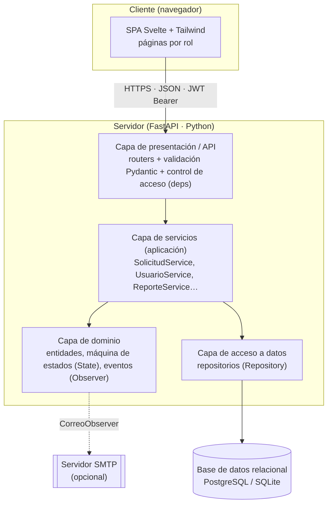

**Justificación**

| Decisión | Motivo |
|---|---|
| Cliente-servidor con API REST | Separa la interfaz de la lógica; la misma API sirve para la web y para una futura app móvil o integración |
| Capas con dependencias hacia abajo | Cada capa tiene una responsabilidad: la API no conoce SQL, los servicios no conocen HTTP. Facilita pruebas y cambios (RNF09) |
| Reglas del ciclo de vida en la capa de dominio | Las reglas de negocio más críticas están en un solo lugar (`domain/estados.py`), no repartidas en controladores |
| Un único despliegue (FastAPI sirve el frontend compilado) | Simplifica la instalación y la sustentación: un proceso, un puerto. Misma estrategia que el proyecto previo PlataformaCUL |

### Tecnologías

| Componente | Tecnología | Justificación |
|---|---|---|
| Backend | **Python 3.12 + FastAPI** | Experiencia previa del equipo (PlataformaCUL); validación automática con tipos; documentación OpenAPI/Swagger generada en `/docs` |
| ORM | **SQLAlchemy 2.0** | Mapea las clases del diseño OO a tablas; independiza del motor (PostgreSQL / SQLite); evita inyección SQL |
| Base de datos | **PostgreSQL 16** (producción), SQLite (desarrollo/pruebas) | Relacional, gratuita, con integridad referencial y restricciones CHECK |
| Autenticación | **JWT (PyJWT) + bcrypt** | Sesiones sin estado en el servidor; contraseñas con hash adaptativo |
| Frontend | **Svelte 4 + Vite + Tailwind CSS** | Ligero y reactivo, poco código; Tailwind permite una interfaz consistente y responsiva |
| Pruebas | **pytest + pytest-cov + TestClient** | Pruebas unitarias y de integración de la API con BD en memoria |
| Despliegue | **Docker + docker-compose** | Mismo entorno en cualquier equipo; levanta BD y aplicación con un comando |
| Control de versiones / CI | **Git + GitHub + GitHub Actions** | Historial del avance; pruebas automáticas en cada push |

## 3.2 Módulos y componentes

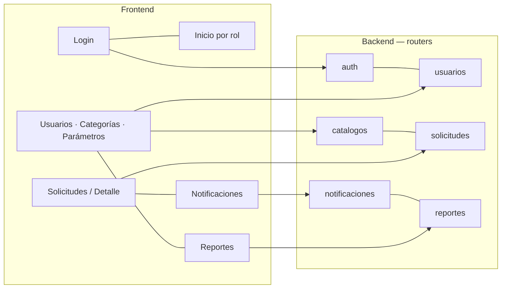

| Módulo obligatorio | Componentes backend | Componentes frontend |
|---|---|---|
| Gestión de usuarios | `routers/usuarios.py`, `UsuarioService`, `UsuarioRepository`, `RolRepository` | `pages/Usuarios.svelte` |
| Gestión de categorías | `routers/catalogos.py`, `CategoriaService`, `ParametroService` | `pages/Categorias.svelte`, `pages/Parametros.svelte` |
| Registro de solicitudes | `routers/solicitudes.py`, `SolicitudService.registrar` | `components/NuevaSolicitud.svelte` |
| Asignación y atención | `SolicitudService.asignar / cambiar_estado / agregar_observacion`, `domain/estados.py` | `pages/SolicitudDetalle.svelte` |
| Seguimiento e historial | `Movimiento`, `SolicitudService.historial` | `pages/Solicitudes.svelte`, línea de tiempo en el detalle |
| Notificaciones | `services/eventos.py`, `NotificacionService`, `routers/notificaciones.py` | Campana en `Layout.svelte`, `pages/Notificaciones.svelte` |
| Reportes y estadísticas | `ReporteService`, `routers/reportes.py` | `pages/Reportes.svelte`, `components/Barras.svelte` |
| Autenticación y acceso | `core/security.py`, `api/deps.py`, `AuthService` | `pages/Login.svelte`, `components/Protegida.svelte`, `lib/api.js` |

Estructura del código:

```
backend/app/
├── main.py              # Arranque, manejo de errores, registro de routers
├── bootstrap.py         # Creación de tablas, catálogos y datos de demostración
├── core/                # Configuración, BD, seguridad (bcrypt/JWT), excepciones de dominio
├── domain/              # Enumeraciones y máquina de estados (patrón State)
├── models/              # Entidades SQLAlchemy (clases del modelo OO)
├── repositories/        # Acceso a datos (patrón Repository)
├── services/            # Lógica de negocio + eventos/notificaciones (patrón Observer)
├── schemas/             # DTOs de entrada/salida (Pydantic)
└── api/                 # Dependencias de seguridad y routers REST
```

## 3.3 Diagrama de clases

### Modelo de dominio (entidades persistentes)

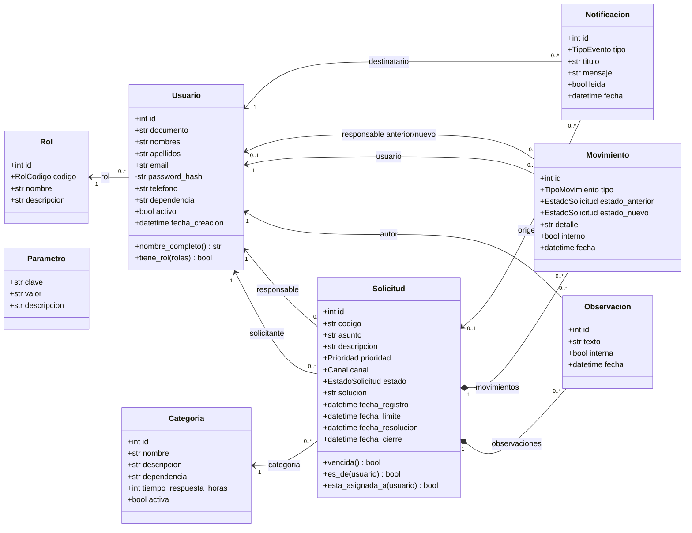

### Ciclo de vida (patrón State)

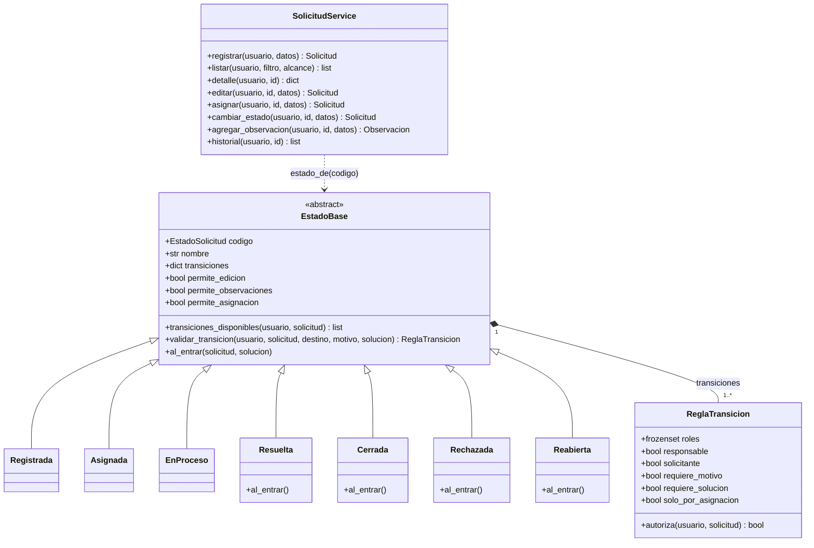

### Notificaciones (patrón Observer) y acceso a datos (patrón Repository)

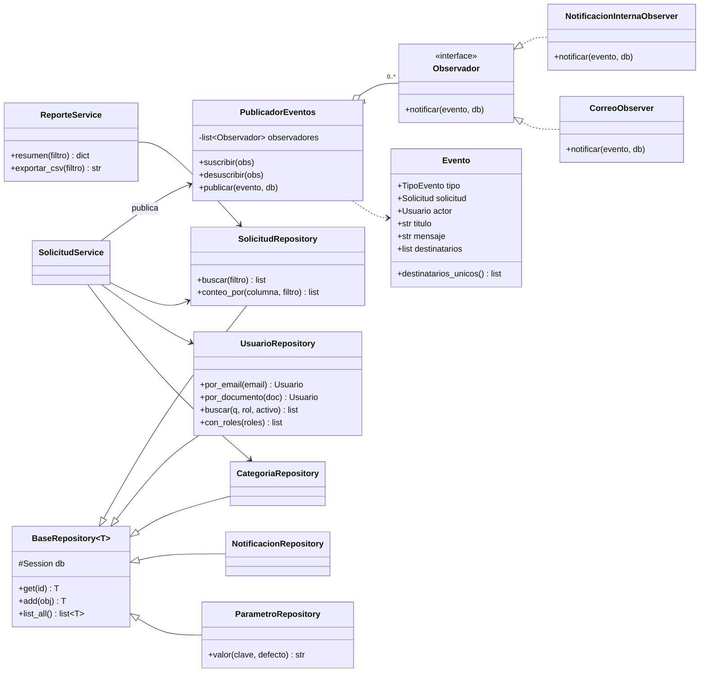

## 3.4 Responsabilidades y colaboraciones (tarjetas CRC)

| Clase | Responsabilidades | Colaboradores |
|---|---|---|
| **Usuario** | Conocer sus datos, su rol y si está activo | Rol |
| **Solicitud** | Conocer sus datos, estado, fechas; saber si está vencida, quién la registró y quién la atiende | Usuario, Categoria, Observacion, Movimiento |
| **Categoria** | Definir el tipo de servicio, la dependencia y el tiempo de respuesta | Solicitud |
| **Movimiento** | Registrar un hecho del historial (quién, cuándo, qué cambió y por qué) | Solicitud, Usuario |
| **Observacion** | Guardar un comentario público o interno | Solicitud, Usuario |
| **Notificacion** | Guardar un aviso para un usuario y si ya fue leído | Usuario, Solicitud |
| **EstadoBase** (y subclases) | Decidir qué transiciones existen, quién las autoriza y qué datos exigen; aplicar efectos al entrar a un estado | ReglaTransicion, Solicitud, Usuario |
| **ReglaTransicion** | Evaluar si un usuario puede ejecutar una transición sobre una solicitud | Usuario, Solicitud |
| **SolicitudService** | Orquestar los casos de uso de solicitudes: validar acceso, delegar en el estado, registrar movimientos, publicar eventos, confirmar la transacción | EstadoBase, repositorios, PublicadorEventos |
| **PublicadorEventos** | Distribuir cada evento a todos los observadores suscritos | Observador, Evento |
| **NotificacionInternaObserver** | Crear notificaciones en la BD para los destinatarios | Notificacion |
| **CorreoObserver** | Enviar correo si está configurado; nunca interrumpir la operación | ParametroRepository, SMTP |
| **Repositorios** | Encapsular consultas a la BD (búsquedas, filtros, conteos) | Session (SQLAlchemy), entidades |
| **ReporteService** | Calcular indicadores y conteos por estado, categoría, prioridad, responsable y periodo; exportar CSV | SolicitudRepository |
| **UsuarioService / AuthService** | Gestionar usuarios y roles / autenticar y emitir tokens | UsuarioRepository, RolRepository, security |

### Secuencia: cambiar estado de una solicitud

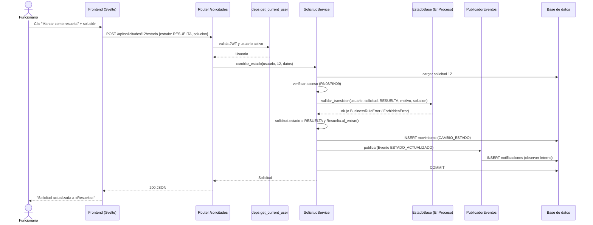

## 3.5 Diseño de la base de datos relacional

El esquema completo (generado desde PostgreSQL) está en [`backend/sql/schema_postgresql.sql`](../backend/sql/schema_postgresql.sql). La aplicación crea las tablas automáticamente al iniciar.

| Tabla | PK | Llaves foráneas | Únicos | Restricciones / índices |
|---|---|---|---|---|
| `roles` | id | — | codigo | CHECK codigo ∈ 4 roles |
| `usuarios` | id | rol_id → roles | documento, email | Índices en documento y email |
| `categorias` | id | — | nombre | CHECK tiempo_respuesta_horas > 0 |
| `solicitudes` | id | solicitante_id, responsable_id → usuarios; categoria_id → categorias | codigo | CHECK estado, prioridad, canal; índices en estado, fecha_registro, solicitante, responsable, categoría |
| `observaciones` | id | solicitud_id (ON DELETE CASCADE), autor_id | — | Índice en solicitud_id |
| `movimientos` | id | solicitud_id (CASCADE), usuario_id, responsable_anterior_id, responsable_nuevo_id | — | CHECK tipo y estados; índices en solicitud_id y fecha |
| `notificaciones` | id | usuario_id (CASCADE), solicitud_id (CASCADE) | — | Índices en usuario_id y leida |
| `parametros` | clave | — | — | — |

**Normalización:** el esquema está en **3FN**. Los datos del solicitante y del responsable no se copian en la solicitud (se referencian por FK); el nombre de la categoría no se repite; el historial vive en su propia tabla en lugar de columnas repetidas. Los estados, prioridades y canales se guardan como texto con restricción CHECK (en vez de tablas catálogo) porque son valores fijos definidos por las reglas de negocio y no los administra el usuario; los roles sí tienen tabla porque se asignan a usuarios y tienen descripción.

## 3.6 Prototipos de interfaz

Los bocetos iniciales se refinaron directamente en la implementación. Pantallas principales:

| Pantalla | Captura |
|---|---|
| Inicio de sesión | 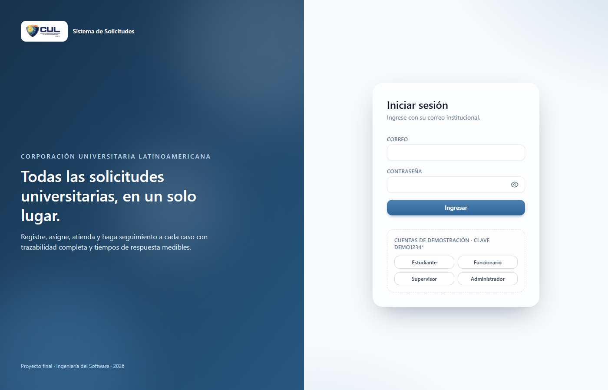 |
| Inicio del estudiante | 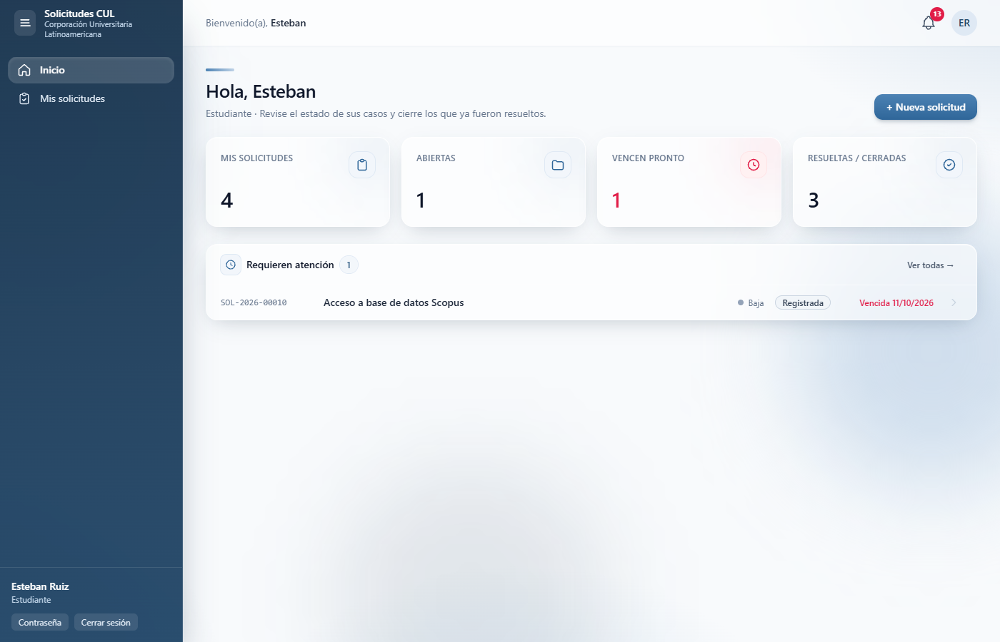 |
| Registrar solicitud | 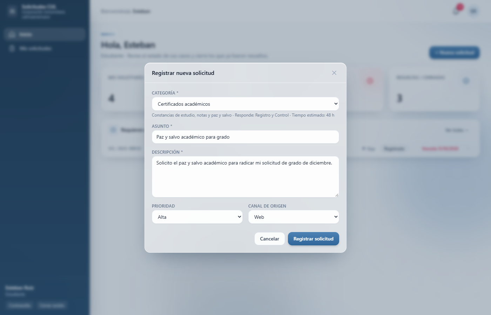 |
| Listado con filtros (supervisor) | 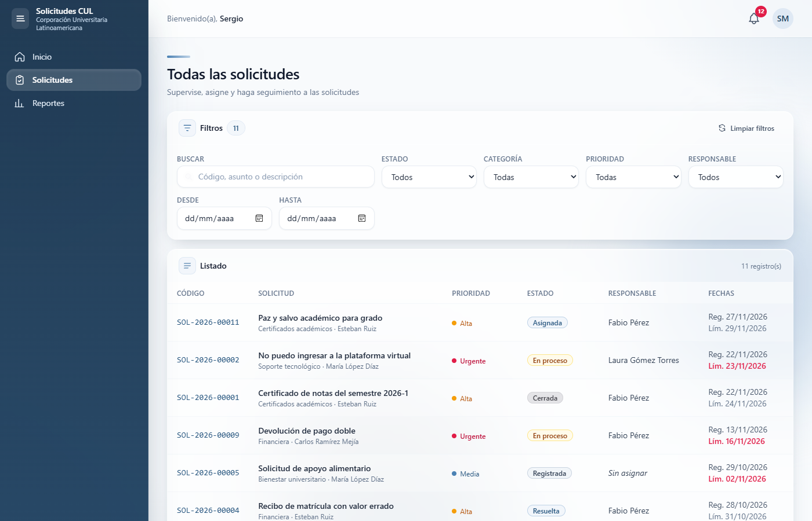 |
| Detalle, observaciones e historial | 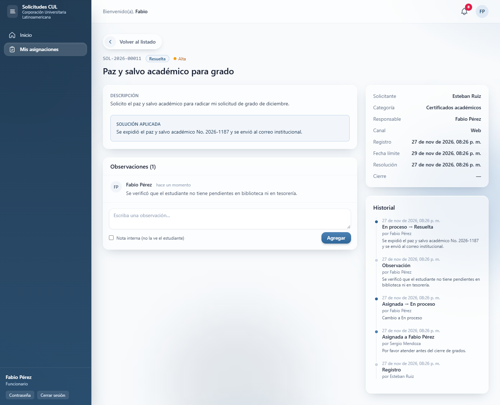 |
| Reportes | 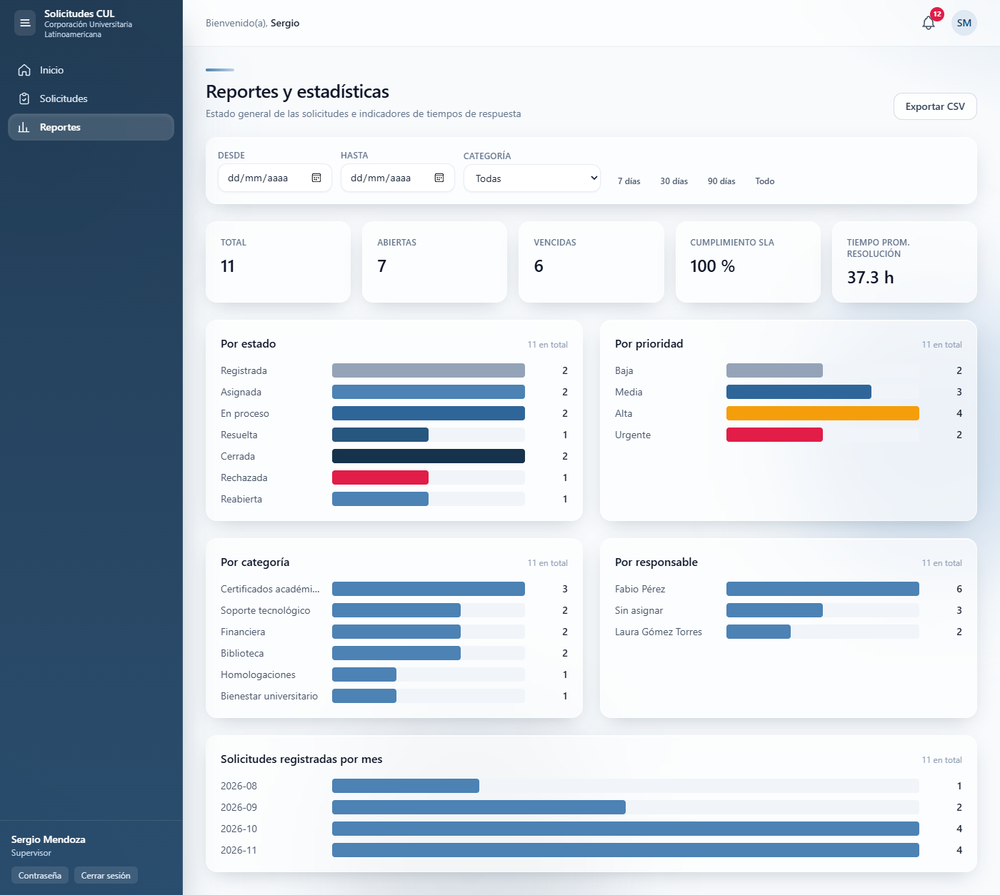 |
| Gestión de usuarios | 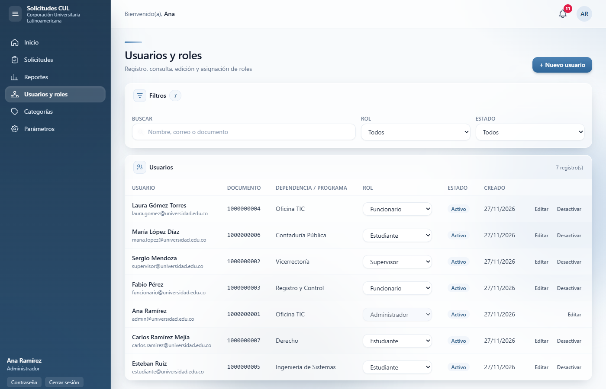 |
| Vista en celular | 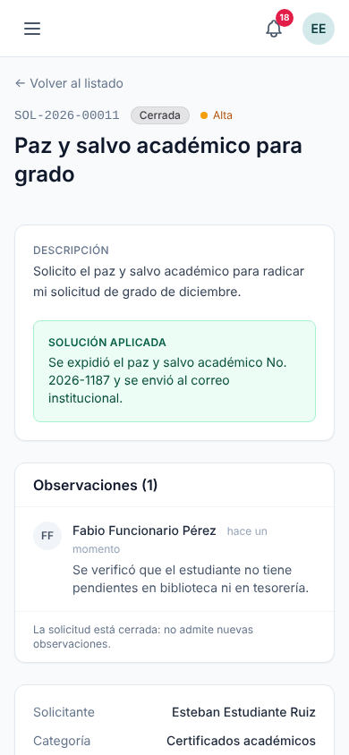 |

Criterios de diseño de interfaz:

- **Un menú por rol**: cada usuario ve solo lo que puede hacer.
- **Acciones contextuales**: el detalle muestra únicamente los botones de las transiciones permitidas para ese usuario en ese estado (los calcula el backend con la máquina de estados).
- **Estados con color consistente** en toda la aplicación (badge) y prioridad con indicador de color.
- **Vencidas resaltadas en rojo** para priorizar la atención.

## 3.7 Patrones de diseño

### Patrón 1 — State (comportamiento)

**Problema:** el comportamiento de una solicitud cambia según su estado: qué transiciones admite, quién puede ejecutarlas, qué datos exige y qué efecto tienen (p. ej. registrar fecha de cierre). Con condicionales (`if estado == ... and rol == ...`) esa lógica se reparte por todo el código y es fácil romper una regla al agregar otra.

**Solución:** cada estado es una clase (`Registrada`, `Asignada`, `EnProceso`, `Resuelta`, `Cerrada`, `Rechazada`, `Reabierta`) que hereda de `EstadoBase` y declara sus transiciones como objetos `ReglaTransicion`. `SolicitudService` (el contexto) obtiene el objeto del estado actual con `estado_de(codigo)` y le delega la validación y los efectos.

**Beneficios en este proyecto:**

- Las reglas RN05, RN06, RN10 y RN11 están en un único archivo (`backend/app/domain/estados.py`) que se lee casi como la tabla de transiciones del análisis.
- La interfaz no repite reglas: el backend devuelve `permisos.transiciones` y el frontend solo dibuja esos botones.
- Agregar un estado nuevo (p. ej. *EN ESPERA DE INFORMACIÓN*) = una clase nueva y su registro, sin tocar el servicio.
- Es fácil de probar de forma aislada (pruebas unitarias parametrizadas de transiciones inválidas).

### Patrón 2 — Observer (comportamiento)

**Problema:** al registrar, asignar, cambiar de estado u observar una solicitud hay que avisar a distintas personas por distintos canales (notificación interna y, opcionalmente, correo). Si `SolicitudService` llamara directamente a cada canal, quedaría acoplado a todos ellos.

**Solución:** `SolicitudService` publica un `Evento` en `PublicadorEventos`; los observadores suscritos (`NotificacionInternaObserver`, `CorreoObserver`) reaccionan de forma independiente. El evento calcula sus destinatarios únicos y excluye al actor.

**Beneficios:** el servicio no conoce los canales; el correo se activa por parámetro sin cambiar código; agregar SMS o Teams es crear otro observador; un fallo del correo no afecta la transacción (el observador captura el error).

### Patrón 3 — Repository (acceso a datos)

**Problema:** mezclar consultas SQL con reglas de negocio dificulta las pruebas y el cambio de motor de BD.

**Solución:** `BaseRepository<T>` con operaciones genéricas y repositorios específicos (`SolicitudRepository.buscar(filtro)`, `conteo_por(columna, filtro)`, `UsuarioRepository.por_email`, …). Los servicios piden datos a los repositorios.

**Beneficios:** el mismo código corre en PostgreSQL y SQLite (las pruebas usan SQLite en memoria); los filtros de búsqueda se definen una sola vez (`FiltroSolicitudes`) y los reutilizan el listado, los reportes y la exportación CSV.

### Otros patrones y principios aplicados

- **Inyección de dependencias** (FastAPI `Depends`): la sesión de BD, el usuario autenticado y la verificación de roles se inyectan en cada endpoint; en las pruebas se reemplaza la BD con `dependency_overrides`.
- **Fábrica simple / registro**: `estado_de(codigo)` devuelve la instancia del estado correspondiente.
- **DTO** (Pydantic): separa lo que entra/sale por la API de las entidades persistentes (nunca se expone `password_hash`).
- **SOLID**: responsabilidad única por servicio; abierto/cerrado en estados y observadores; inversión de dependencias en servicios → repositorios.
