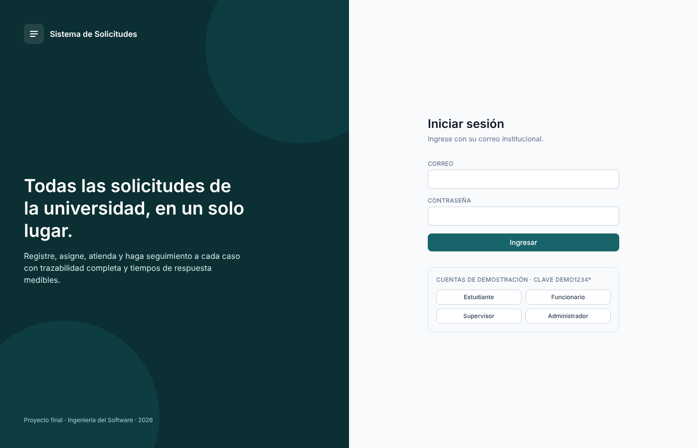
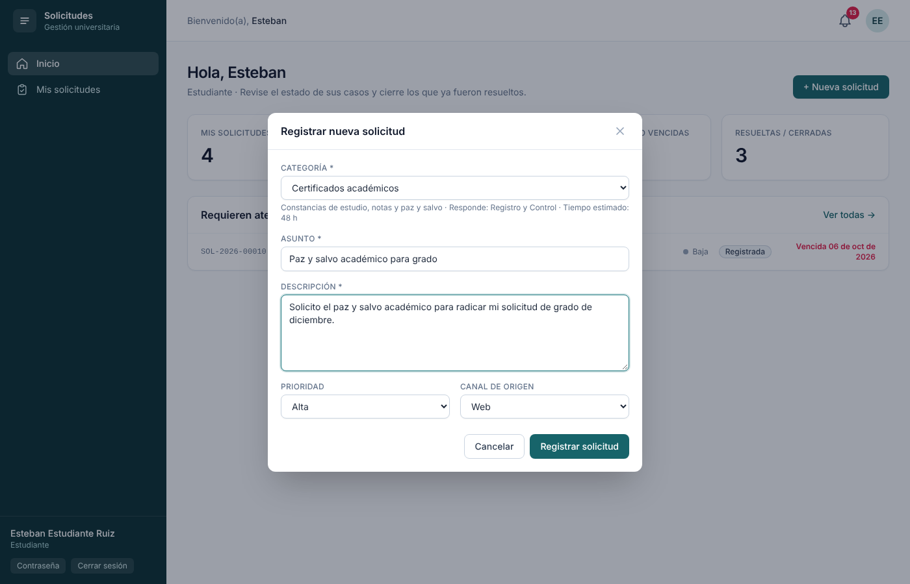
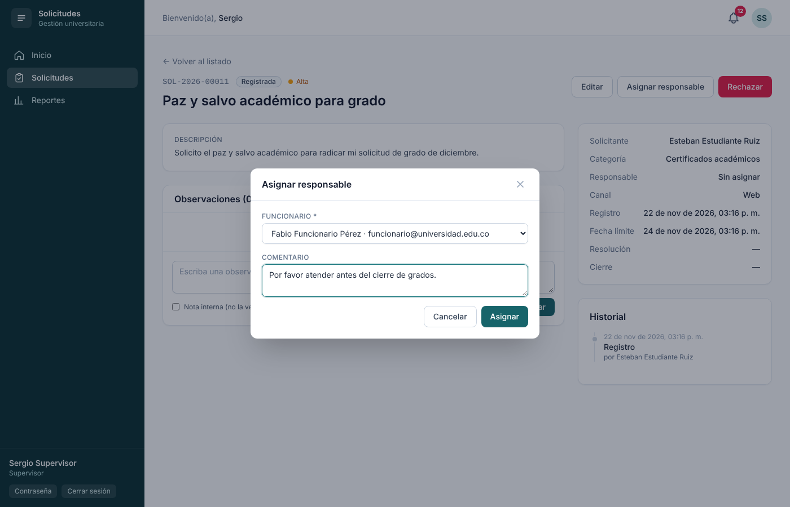
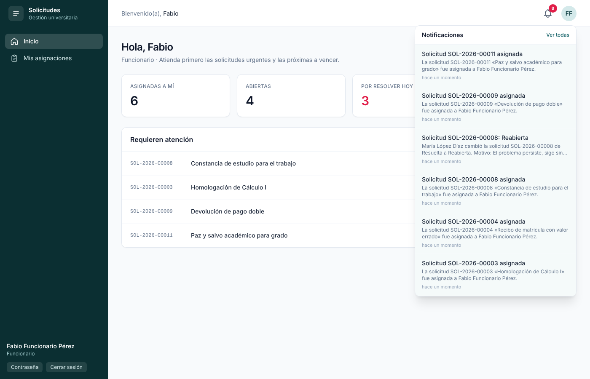
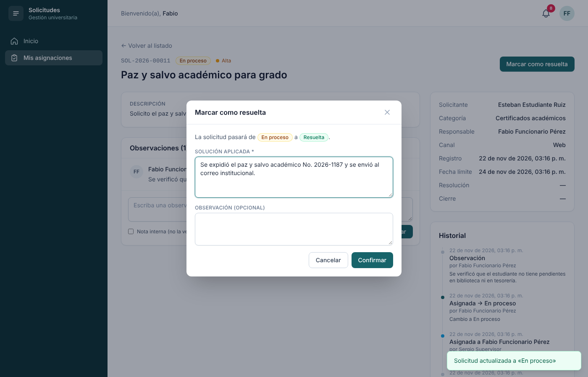
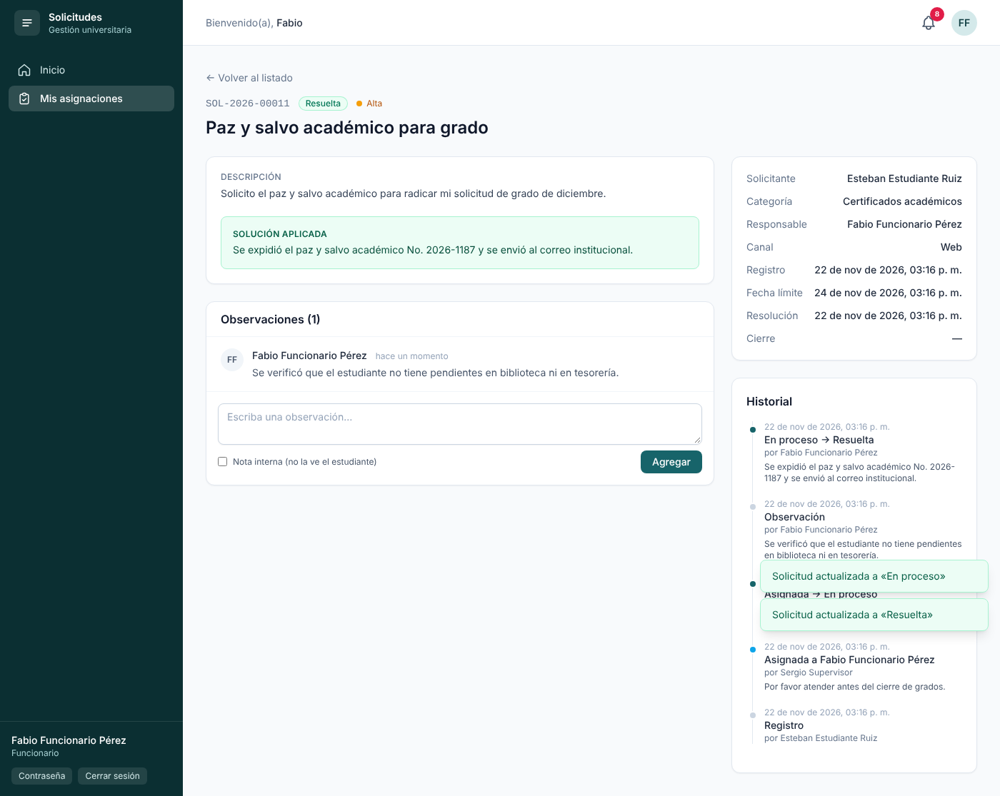
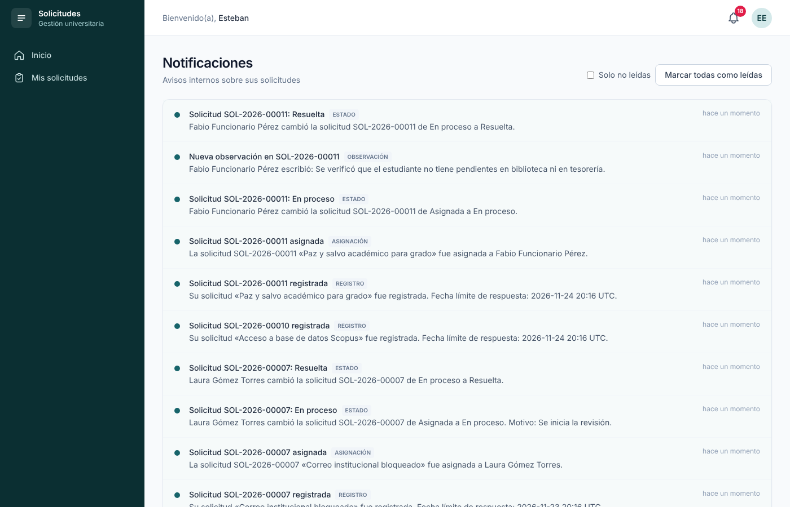
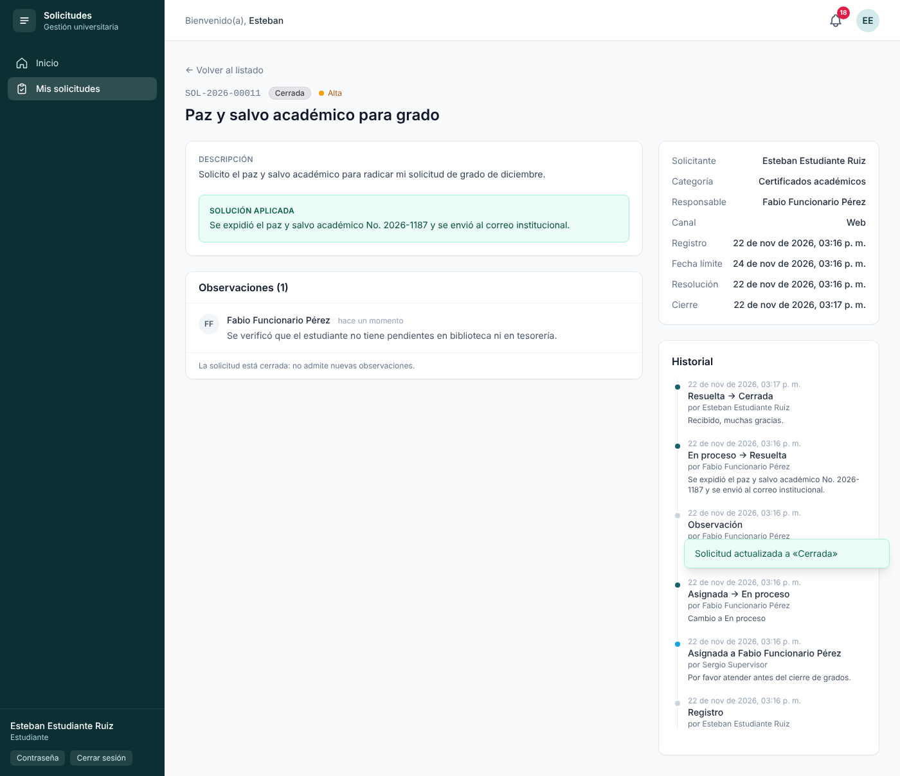
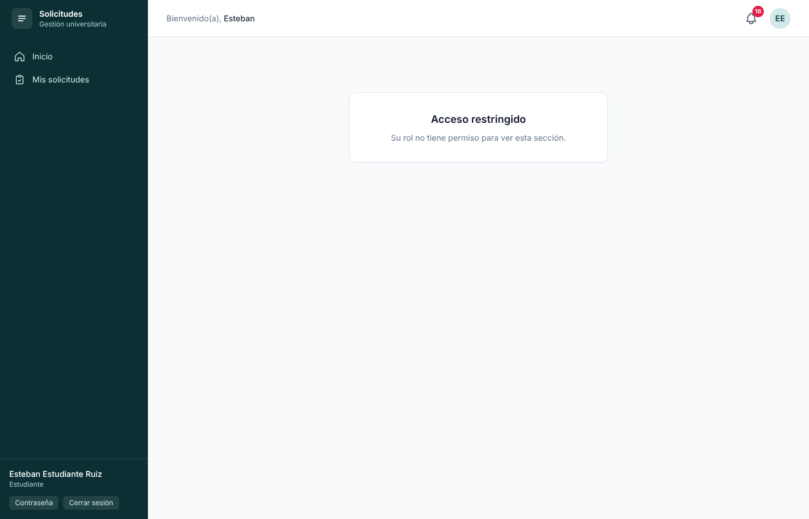
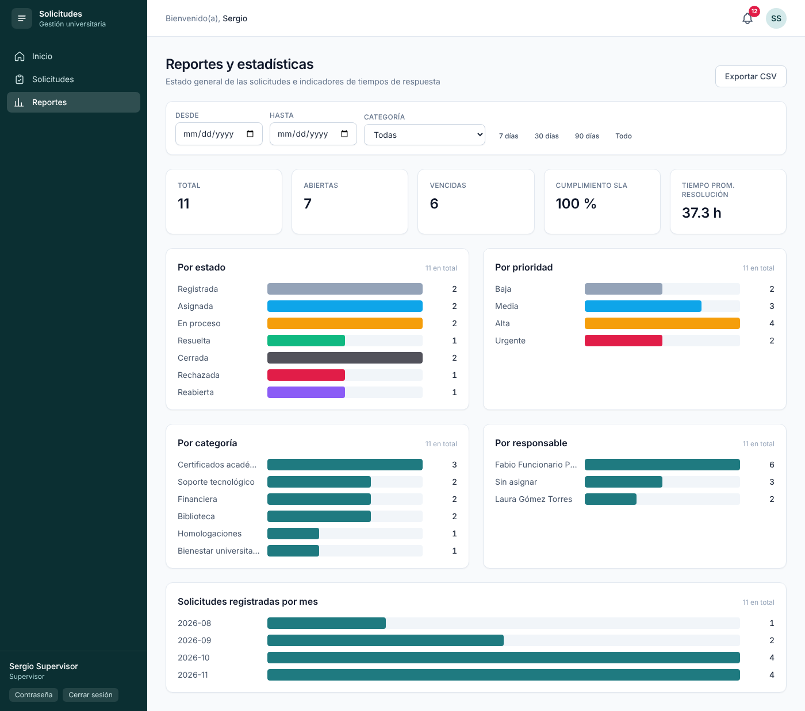

# Entrega 4 — Implementación y pruebas

## 4.1 Módulos implementados

| Módulo obligatorio | Estado | Evidencia |
|---|---|---|
| Gestión de usuarios (registro, consulta, edición, roles, activar/desactivar) | ✅ Completo | [16-usuarios](img/16-usuarios.png), [19-nuevo-usuario](img/19-nuevo-usuario.png) |
| Gestión de categorías (y parámetros) | ✅ Completo | [17-categorias](img/17-categorias.png), [18-parametros](img/18-parametros.png) |
| Registro de solicitudes | ✅ Completo | [03-registrar-solicitud](img/03-registrar-solicitud.png) |
| Asignación y atención | ✅ Completo | [06-asignar-responsable](img/06-asignar-responsable.png), [11-resolver-solicitud](img/11-resolver-solicitud.png) |
| Seguimiento e historial | ✅ Completo | [04-mis-solicitudes](img/04-mis-solicitudes-estudiante.png), [14-solicitud-cerrada](img/14-solicitud-cerrada.png) |
| Notificaciones (internas + correo opcional) | ✅ Completo | [09-notificaciones-panel](img/09-notificaciones-panel.png), [13-notificaciones-estudiante](img/13-notificaciones-estudiante.png) |
| Reportes y estadísticas (+ exportación CSV) | ✅ Completo | [08-reportes](img/08-reportes.png) |

Se implementaron los **7 módulos** (el enunciado exige mínimo 5), los **4 roles** y el **ciclo de vida completo con los 7 estados**.

## 4.2 Autenticación y control de acceso

- **Inicio de sesión**: `POST /api/auth/login` verifica la contraseña con bcrypt y devuelve un **JWT** firmado (HS256) con el id y el rol del usuario y una expiración configurable (120 min por defecto).
- **Cada petición** envía `Authorization: Bearer <token>`. La dependencia `get_current_user` valida la firma, la expiración y que el usuario siga activo.
- **Autorización por rol**: `require_roles(...)` protege los endpoints de administración y reportes. Las reglas finas (dueño de la solicitud, responsable asignado) se validan en los servicios y en la máquina de estados.
- **Frontend**: el menú y las rutas se filtran por rol (`Protegida.svelte`), pero **la seguridad real está en el servidor**: aunque alguien llame la API directamente, recibe 401/403.

### Matriz de permisos

| Operación | Estudiante | Funcionario | Supervisor | Administrador |
|---|:-:|:-:|:-:|:-:|
| Registrar solicitud | ✅ | ✅ | — | — |
| Ver solicitudes | Solo propias | Asignadas y propias | Todas | Todas |
| Editar asunto/descripción | Propia y REGISTRADA | Propia y REGISTRADA | — | — |
| Reclasificar categoría/prioridad | — | — | ✅ | ✅ |
| Asignar / reasignar responsable | — | — | ✅ | ✅ |
| Iniciar atención / resolver | — | Si está asignado | — | — |
| Rechazar | — | Si está asignado | ✅ | ✅ |
| Cerrar solicitud resuelta | Propia | — | ✅ | ✅ |
| Reabrir resuelta | Propia | — | ✅ | ✅ |
| Reabrir cerrada o rechazada | — | — | ✅ | ✅ |
| Observaciones | Públicas | Públicas e internas | Públicas e internas | Públicas e internas |
| Reportes y exportación | — | — | ✅ | ✅ |
| Usuarios, roles, categorías, parámetros | — | — | — | ✅ |

## 4.3 Evidencias de funcionamiento

Recorrido completo de una solicitud (capturas tomadas sobre la aplicación en ejecución con datos de demostración):

| # | Paso | Captura |
|---|---|---|
| 1 | El estudiante inicia sesión |  |
| 2 | Registra una solicitud: queda **REGISTRADA** con código y fecha límite |  |
| 3 | El supervisor la asigna a un funcionario |  |
| 4 | El funcionario recibe la notificación |  |
| 5 | El funcionario la atiende y no puede resolver sin escribir la solución |  |
| 6 | La solicitud queda **RESUELTA** con su historial |  |
| 7 | El estudiante recibe los avisos |  |
| 8 | El estudiante la **CIERRA**: ya no admite observaciones |  |
| 9 | Un estudiante que intenta entrar a Usuarios ve "Acceso restringido" (y la API responde 403) |  |
| 10 | El supervisor consulta los reportes |  |

Otras capturas: [inicio del supervisor](img/05-inicio-supervisor.png), [listado del supervisor](img/07-listado-supervisor.png), [asignadas al funcionario](img/10-asignadas-funcionario.png), [vista en celular](img/20-movil.png).

La API también se puede probar en **http://localhost:8000/docs** (Swagger UI generado por FastAPI), con los 32 endpoints documentados.

## 4.4 Plan de pruebas

| Nivel | Qué se prueba | Herramienta | Ubicación |
|---|---|---|---|
| Unitarias | Máquina de estados (transiciones válidas e inválidas, permisos), publicador de eventos, hash de contraseñas | pytest | `tests/test_reportes_y_estados.py`, `tests/test_auth_roles.py` |
| Integración (API) | Endpoints completos con BD SQLite en memoria: reglas de negocio, permisos por rol, validaciones, notificaciones, reportes | pytest + FastAPI TestClient | `tests/test_solicitudes.py`, `tests/test_auth_roles.py` |
| Sistema / funcional | Flujos completos en el navegador por cada rol | Playwright (recorrido automatizado) + revisión manual | Capturas en `docs/img/` |
| Rendimiento | Tiempo de respuesta con 10.000 solicitudes en PostgreSQL | curl + datos sintéticos | Sección 4.6 |
| Integración continua | Pruebas y compilación del frontend en cada push | GitHub Actions | `.github/workflows/ci.yml` |

Cada prueba de integración crea una base de datos nueva en memoria con los datos de demostración, así que las pruebas son independientes entre sí y repetibles.

## 4.5 Casos de prueba y resultados

**Resultado: 43 pruebas, 43 aprobadas (100 %). Cobertura del backend: 92 %.**

| ID | Caso de prueba | Requisito / regla | Resultado esperado | Estado |
|---|---|---|---|:-:|
| CP01 | Contraseña guardada con hash y verificable | RNF01 | Hash bcrypt ≠ texto plano | ✅ |
| CP02 | Login correcto devuelve token y rol, sin `password_hash` | RF01 | 200 + token | ✅ |
| CP03 | Login con clave incorrecta | RF01, RNF03 | 401 | ✅ |
| CP04 | Endpoint protegido sin token o con token falso | RNF02 | 401 | ✅ |
| CP05 | Solo el administrador gestiona usuarios | RF02 | 200 admin / 403 resto | ✅ |
| CP06 | Crear usuario, correo duplicado, cambiar rol | RF02 | 201 / 409 / rol actualizado | ✅ |
| CP07 | Usuario inactivo no puede iniciar sesión | RN14 | 401 | ✅ |
| CP08 | No se puede quitar el último administrador | RN14 | 422 | ✅ |
| CP09 | Validación de datos obligatorios del usuario | RNF07 | 422 | ✅ |
| CP10 | Cambio de contraseña | RF15 | 204 y login con la nueva | ✅ |
| CP11 | Gestión de categorías; inactiva no se ofrece | RF03 | 201; no aparece en lista | ✅ |
| CP12 | Registro: estado inicial, código y fecha límite | RF04, RN03 | REGISTRADA, `SOL-…`, fecha límite | ✅ |
| CP13 | Registro con categoría inexistente | RN02 | 422 | ✅ |
| CP14 | Registro con datos incompletos | RNF07 | 422 | ✅ |
| CP15 | El supervisor no registra solicitudes | RN01 | 403 | ✅ |
| CP16 | El estudiante solo ve sus solicitudes; no ve las de otro | RF05, RN08 | Lista filtrada; 403 en detalle ajeno | ✅ |
| CP17 | El funcionario ve solo las asignadas | RF06, RN09 | 403 antes de asignar; aparece después | ✅ |
| CP18 | Solo staff asigna; el responsable debe ser funcionario | RN04 | 403 / 422 / 200 ASIGNADA | ✅ |
| CP19 | Ciclo completo: no saltar estados, solo el asignado atiende, RESUELTA exige solución, CERRADA no se modifica, reapertura solo autorizada con motivo | RF07, RN05, RN06, RN10, RN11 | Códigos 422/403 en cada violación; transiciones válidas aplicadas | ✅ |
| CP20 | Historial con tipo, estados, usuario, motivo y fecha | RF09, RN07 | 3 movimientos con datos completos | ✅ |
| CP21 | Rechazo sin motivo | RN11 | 422 | ✅ |
| CP22 | Reasignar desde EN_PROCESO vuelve a ASIGNADA; el anterior pierde acceso | RN04, RN09 | ASIGNADA; 403 al anterior | ✅ |
| CP23 | Observación interna oculta al estudiante | RF08, RN13 | Estudiante ve 1, funcionario 2 | ✅ |
| CP24 | El estudiante edita solo en REGISTRADA | RN12 | 200 y luego 422 | ✅ |
| CP25 | Permisos calculados según el usuario | RF07 | Funcionario ve "EN_PROCESO"; estudiante ninguna | ✅ |
| CP26 | Notificaciones al registrar, asignar y actualizar; marcar todas leídas | RF10 | Contadores e tipos correctos | ✅ |
| CP27 | No se puede marcar una notificación ajena | RNF02 | 404 | ✅ |
| CP28 | Parámetros: solo admin, validados y usados al generar el código | RF13 | 403 / 422 / código `PQRS-…` | ✅ |
| CP29 | Categoría con nombre duplicado | RNF06 | 409 | ✅ |
| CP30 | Reportes solo para supervisor y admin | RF11 | 200 / 403 | ✅ |
| CP31 | Totales del reporte consistentes (suma por estado = total, etc.) | RF11 | Igualdades verificadas | ✅ |
| CP32 | Reporte filtrado por estado y periodo | RF11 | 2 cerradas; 0 en el año 2000 | ✅ |
| CP33 | Exportar CSV | RF14 | Encabezado + 10 filas | ✅ |
| CP34 | La máquina de estados coincide con el diagrama de diseño | RN10 | Diccionario idéntico | ✅ |
| CP35–39 | Transiciones inválidas (5 casos parametrizados) | RN10 | `BusinessRuleError` | ✅ |
| CP40 | Funcionario no asignado no resuelve | RN10 | `ForbiddenError` | ✅ |
| CP41 | CERRADA no admite observaciones | RN06 | `permite_observaciones = False` | ✅ |
| CP42 | El publicador notifica a todos los observadores | Patrón Observer | 2 notificaciones | ✅ |
| CP43 | El evento excluye al actor, duplicados e inactivos | RF10 | Solo el destinatario válido | ✅ |

Ejecución:

```
$ cd backend && pytest --cov=app
43 passed in 6.7s
TOTAL   1396 stmts   107 miss   92%
```

## 4.6 Prueba de rendimiento (RNF11)

Se cargaron **10.000 solicitudes sintéticas** en PostgreSQL 16 y se midió el peor de 3 tiempos de respuesta de cada consulta (servidor y cliente en la misma máquina):

| Consulta | Tiempo |
|---|---|
| Reporte resumen sobre las 10.000 solicitudes | 0,14 s |
| Reporte de los últimos 30 días | 0,02 s |
| Listado del estudiante | 0,14 s |
| Listado del funcionario | 0,09 s |
| Listado filtrado por estado + búsqueda | 0,02 s |
| Detalle de una solicitud | 0,02 s |
| Notificaciones | 0,01 s |
| Listado general del supervisor (límite 500) | 0,10 s |

Todas cumplen el objetivo de < 1 s. **Hallazgo y corrección:** el listado general sin límite tardaba 0,75 s con 10.000 registros y crecería con el tiempo; se agregó el parámetro `limite` (500 por defecto, más recientes primero) y la interfaz avisa que se deben usar los filtros para acotar.

## 4.7 Métricas del producto

| Métrica | Valor | Herramienta |
|---|---|---|
| Líneas de código backend (sin comentarios ni vacías) | ≈ 1.800 | `wc` |
| Líneas de código de pruebas | ≈ 340 | `wc` |
| Líneas de código frontend (Svelte/JS) | ≈ 1.300 | `wc` |
| Clases principales del modelo OO (entidades) | 8 (`Rol`, `Usuario`, `Categoria`, `Solicitud`, `Observacion`, `Movimiento`, `Notificacion`, `Parametro`) | — |
| Clases de dominio y servicios (estados, observadores, repositorios, servicios) | 29 | — |
| Endpoints REST | 32 | FastAPI / OpenAPI |
| Tablas de la BD | 8, con 9 restricciones CHECK | PostgreSQL |
| Pruebas automatizadas | 43 (100 % aprobadas) | pytest |
| Cobertura de código del backend | 92 % | pytest-cov |
| Complejidad ciclomática promedio | **A (2,3)**; ninguna función de la aplicación supera el rango C | radon |
| Índice de mantenibilidad | Todos los módulos en rango **A** | radon |
| Requisitos funcionales con al menos una prueba | 16 de 16 | Matriz CP ↔ RF |

**Acción derivada de las métricas:** `ReporteService.resumen` tenía complejidad **D (26)**; se dividió en funciones auxiliares (`_indicadores_tiempo`, `_items`, `_nombres_responsables`) y bajó a **A (4)**, sin cambiar el comportamiento (las 43 pruebas siguieron aprobando).
